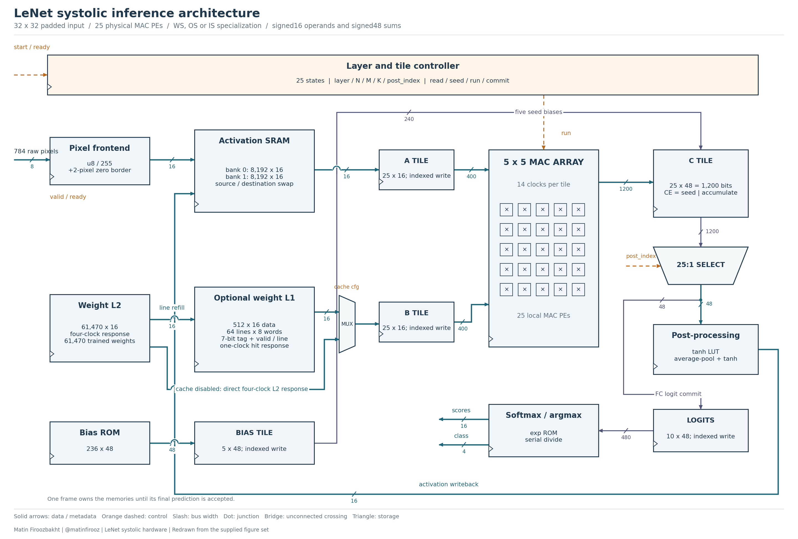

# LeNet Systolic Inference

**Matin Firoozbakht** | [@matinfirooz](https://github.com/matinfirooz)

A complete Fashion-MNIST classifier with a trained PyTorch LeNet, an integer reference,
and **three physical 5x5 systolic dataflows: WS, OS and IS**. The 26 RTL modules implement
the full network: zero padding, convolutions, average pooling, tanh, dense layers,
softmax and held prediction outputs. A **1 KiB SRAM cache** and a **four-cycle L2 memory**
provide two reproducible weight-memory configurations.



## Verified results

| Implementation | Official test images | Correct | Accuracy |
| --- | --- | --- | --- |
| PyTorch float32 | 10000 | 8884 | 88.84% |
| Integer Q12 reference | 10000 | 8884 | 88.84% |

The float/integer prediction agreement is **99.89%**;
11 decisions differ despite the equal aggregate accuracy.
Weights and biases have **0 clipping events** during export.

| Dataflow | Weight memory | Compute cycles | Frame cycles | Start interval | RTL cohort |
| --- | --- | --- | --- | --- | --- |
| WS | L2 only | 1,101,438 | 1,103,246 | 1,103,248 | 16/16 |
| WS | 1 KiB L1 + L2 | 1,082,295 | 1,084,103 | 1,084,105 | 16/16 |
| OS | L2 only | 1,101,438 | 1,103,246 | 1,103,248 | 16/16 |
| OS | 1 KiB L1 + L2 | 1,082,295 | 1,084,103 | 1,084,105 | 16/16 |
| IS | L2 only | 1,101,438 | 1,103,246 | 1,103,248 | 16/16 |
| IS | 1 KiB L1 + L2 | 1,082,295 | 1,084,103 | 1,084,105 | 16/16 |

**RTL scope:** each of the six configurations checks the same 16 official test images,
all 8,084 intermediate activations per image, all ten logits, all ten probabilities
and the class. The 10,000-image accuracy above is measured by PyTorch and the integer
reference; it is not presented as a 10,000-image RTL simulation result. Additional tests
exercise signed extremes, cache conflicts, memory stalls, score/prediction stalls,
busy-start rejection and reset cancellation.

There are **9 passing generic Yosys synthesis/connectivity checks**.
Vivado mapped resources, routed timing and power are **unmeasured**. A 100 MHz clock
is a constraint target, not an achieved device frequency.

## Network and numeric contract

The network is 32x32 -> C1(6) -> S2 -> C3(16) -> S4 -> C5(120) -> F6(84) -> F7(10).
All convolutions, pooling stages and F6 use tanh; F7 uses softmax. The model contains
**61,706 parameters** and performs **416,520 useful MACs per image**. Inputs are u8/255
with a two-pixel zero border. Weights and activations use signed 16-bit Q12; biases
and accumulators use signed 48-bit Q24. Probability outputs use unsigned Q16.

## Quick start

Use Python 3.12 with the included checkpoint and verified dataset files:

```bash
python -m venv .venv
# Linux/macOS: source .venv/bin/activate
# Windows PowerShell: .venv\Scripts\Activate.ps1
python -m pip install torch==2.5.1 --index-url https://download.pytorch.org/whl/cpu
python -m pip install -r requirements.txt
jupyter lab HW3_Matin_Firoozbakht.ipynb
```

The notebook defaults to the saved checkpoint and measured evidence. Training and
RTL simulation are controlled by explicit switches. No dataset download is needed
when using the included data directory.

## Reproduce results

```bash
# Optional: train 20 epochs on 54,000 images; validate on 6,000.
python scripts/train.py --epochs 20 --threads 4
python scripts/export_evaluate.py --rtl-images 16
python scripts/benchmark_software.py --threads 1
python -m unittest discover -s tests -v
python scripts/run_verification.py --samples 16 --jobs 3
python -m pip install pyosys
python scripts/run_generic_synthesis.py
python scripts/build_report.py
python scripts/render_figures.py
```

Icarus Verilog (`iverilog`, `vvp`) is required for simulation. `IVERILOG`, `VVP` and
`IVL_BASE` support nonstandard installations. Saved evidence is checked against
source, ROM and dataset hashes. A larger RTL cohort can be generated with
`export_evaluate.py --rtl-images N`, then simulated with `run_verification.py --samples N`.

## Vivado

```bash
python scripts/run_vivado.py
python scripts/parse_vivado.py
vivado -mode gui -source hardware/scripts/open_checkpoint.tcl -tclargs ws 0 post_route
```

All six flows use `xc7a100tcsg324-1`, a 10 ns clock target and identical I/O timing
constraints by default. `FPGA_PART`, `CLOCK_PERIOD_NS`, `LENET_DATAFLOW` and
`LENET_CACHE` select an individual build. The flow implements an out-of-context IP
core and writes real checkpoints plus utilization, timing, DRC and power reports.
`LENET_SAIF` and `LENET_SAIF_SCOPE` provide activity for power estimation; otherwise
the estimate is vectorless. Board pin mapping and bitstream programming are separate.

## Documentation and files

- [Complete answers](COMPLETE_ANSWERS.md): every implementation and evaluation question.
- [Executed notebook](HW3_Matin_Firoozbakht.ipynb): software, all RTL sources, figures and measured results.
- [Hardware guide](hardware/README.md), [port catalog](hardware/module_ports.csv) and [architecture metadata](hardware/architecture.json).
- [Specification decisions](docs/SPECIFICATION.md) and original source documents in `docs/`.
- `software/`: PyTorch model/checkpoint, all trained parameters and integer inference.
- `hardware/rtl/`: 26 modules; `hardware/tb/`: arithmetic, memory, full-network and protocol tests.
- `hardware/mem/`: trained ROMs and independent per-image reference traces.
- `results/software/`: full test predictions, training, quantization and CPU timing.
- `results/hardware/`: actual simulation logs, cycle/traffic measurements and generic synthesis.
- `hardware/figures/`, `results/figures/`: editable SVG and high-resolution PNG figures.
- `data/fashion/`: official IDX/gzip files, checksums and the dataset license.

## Interfaces

Start on `start && start_ready`; transfer 784 u8 pixels on `pixel_valid && pixel_ready`.
The core clears the 32x32 input bank and inserts the zero border itself. Ten score
records transfer on `score_valid && score_ready`, followed by a held class on
`prediction_valid && prediction_ready`. Blocked payloads remain stable. Synchronous
active-high reset cancels a frame. All three static top modules expose the same ports.
