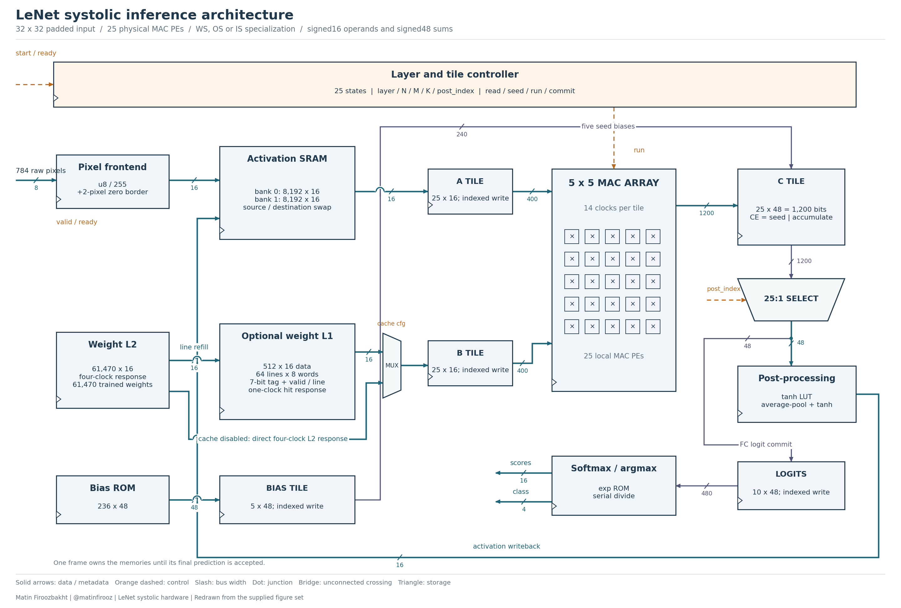
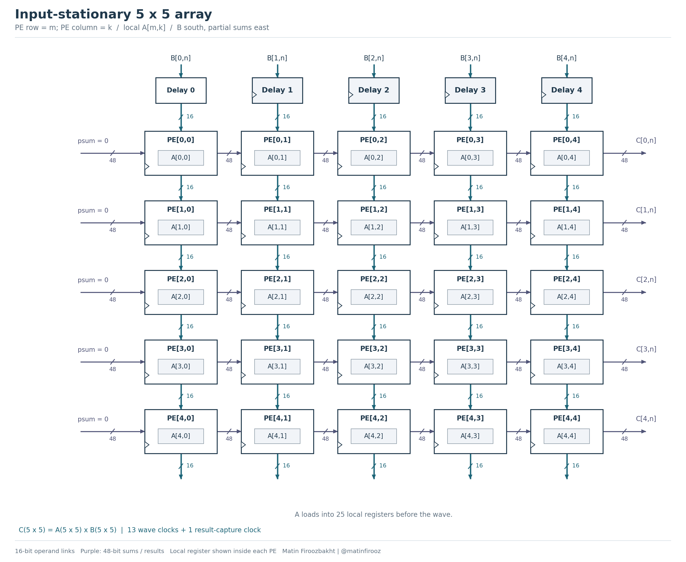
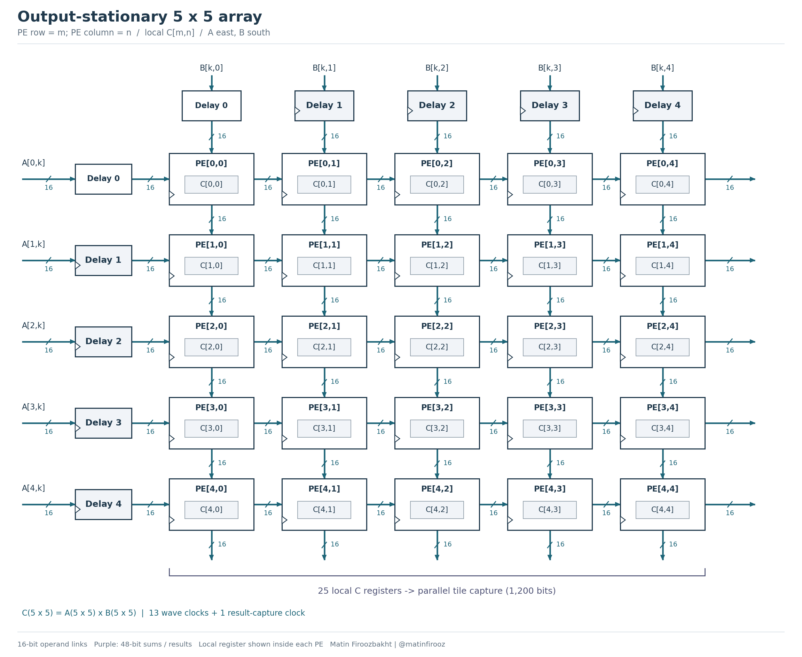
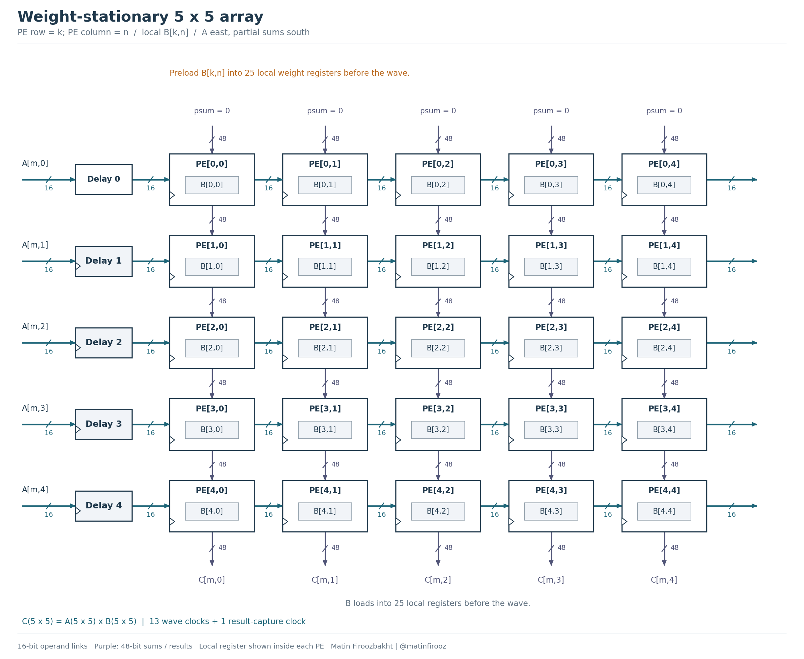
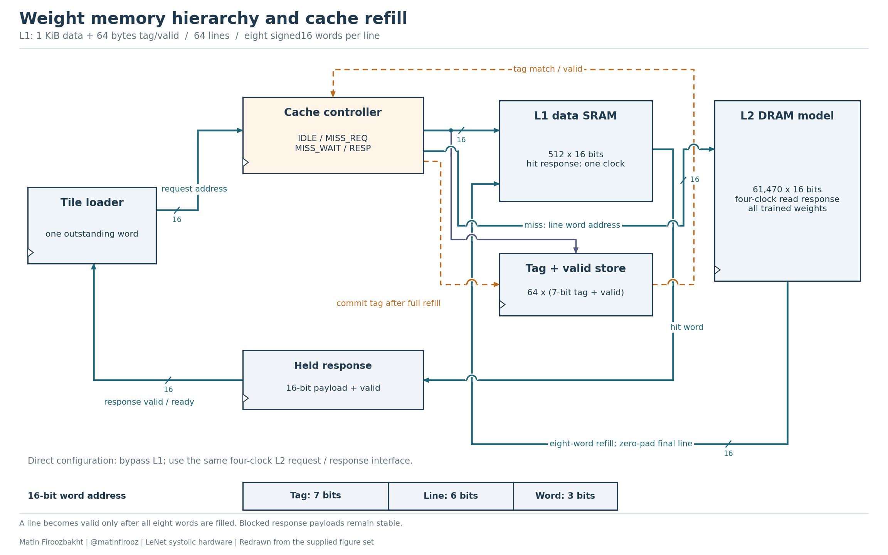
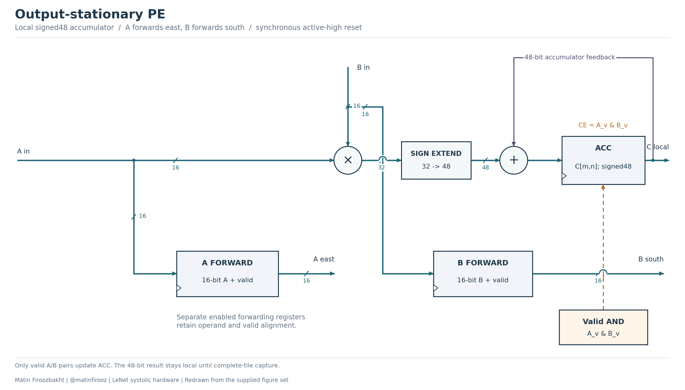
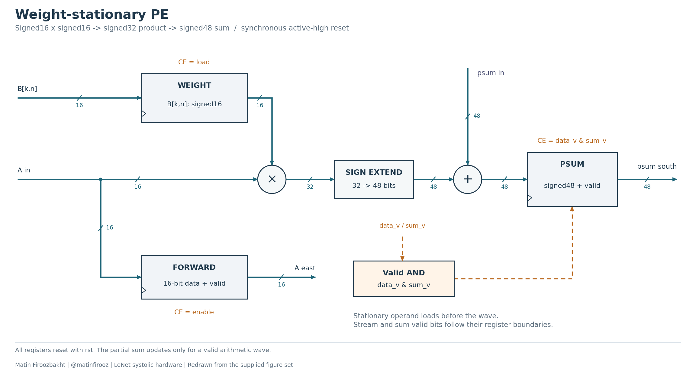
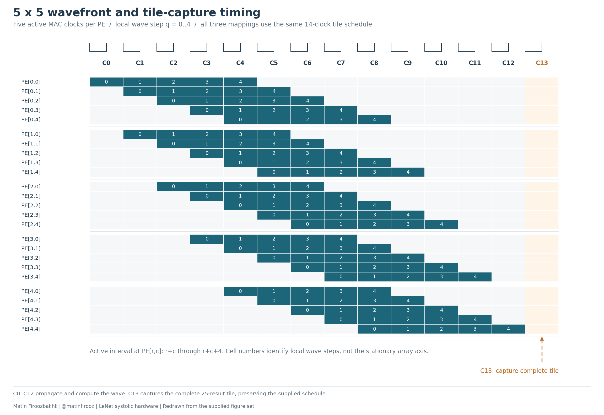

# LeNet Hardware Guide

**Matin Firoozbakht** | [@matinfirooz](https://github.com/matinfirooz)

The three static tops are `lenet_top_ws`, `lenet_top_os` and `lenet_top_is`. Set `CACHE_ENABLE` to 0 or 1. Every top owns and computes the complete network from raw pixels.

| Module | Role | Source |
| --- | --- | --- |
| activation_memory | Two synchronous activation/output banks | [RTL](../hardware/rtl/activation_memory.v) |
| argmax_serial | Negative-safe signed comparison and first-index ties | [RTL](../hardware/rtl/argmax_serial.v) |
| average_pool | Exact four-input mean in Q24 before tanh | [RTL](../hardware/rtl/average_pool.v) |
| bias_rom | 236 signed Q24 biases | [RTL](../hardware/rtl/bias_rom.v) |
| dram_model | Four-cycle held-response weight memory | [RTL](../hardware/rtl/dram_model.v) |
| fraction_divider | Sixteen-step restoring Q16 probability divider | [RTL](../hardware/rtl/fraction_divider.v) |
| layer_config | Seven fixed layer descriptors | [RTL](../hardware/rtl/layer_config.v) |
| lenet_core | Complete image ownership, layer/tile sequencing and I/O | [RTL](../hardware/rtl/lenet_core.v) |
| lenet_top_is | IS synthesis top | [RTL](../hardware/rtl/lenet_top_is.v) |
| lenet_top_os | OS synthesis top | [RTL](../hardware/rtl/lenet_top_os.v) |
| lenet_top_ws | WS synthesis top | [RTL](../hardware/rtl/lenet_top_ws.v) |
| patch_address | On-demand convolution/dense activation address | [RTL](../hardware/rtl/patch_address.v) |
| pe_is | Stationary activation, south weight, east partial sum | [RTL](../hardware/rtl/pe_is.v) |
| pe_os | Local output accumulation with east A/south B | [RTL](../hardware/rtl/pe_os.v) |
| pe_ws | Stationary weight, east activation, south partial sum | [RTL](../hardware/rtl/pe_ws.v) |
| pixel_frontend | u8 normalization and 28x28-to-32x32 address mapping | [RTL](../hardware/rtl/pixel_frontend.v) |
| pool_address | Four addresses per pooled output | [RTL](../hardware/rtl/pool_address.v) |
| sa_is_5x5 | 5x5 IS grid and right-edge result gathering | [RTL](../hardware/rtl/sa_is_5x5.v) |
| sa_os_5x5 | 5x5 OS grid and parallel accumulator capture | [RTL](../hardware/rtl/sa_os_5x5.v) |
| sa_tile_engine | Static dataflow selection at elaboration | [RTL](../hardware/rtl/sa_tile_engine.v) |
| sa_ws_5x5 | 5x5 WS grid and bottom-edge result gathering | [RTL](../hardware/rtl/sa_ws_5x5.v) |
| softmax10 | Maximum, exp table, denominator, probabilities and held class | [RTL](../hardware/rtl/softmax10.v) |
| tanh_lut | Overflow-safe Q24 to Q12 activation lookup | [RTL](../hardware/rtl/tanh_lut.v) |
| tile_accumulator | 25 biased 48-bit accumulators across reduction tiles | [RTL](../hardware/rtl/tile_accumulator.v) |
| weight_cache | 1 KiB direct-mapped SRAM with chained L2 line refill | [RTL](../hardware/rtl/weight_cache.v) |
| weight_memory | Direct/cached memory specialization | [RTL](../hardware/rtl/weight_memory.v) |

## Figures

## Ports

Widths are extracted from the actual RTL headers; [CSV](module_ports.csv) and [JSON](architecture.json) contain the complete catalog. All resets are synchronous active high.

### activation_memory

| Port | Direction | Width | Signed |
| --- | --- | --- | --- |
| clk | input | 1 | False |
| read_enable | input | 1 | False |
| read_bank | input | 1 | False |
| read_address | input | [12:0] | False |
| read_data | output | [15:0] | True |
| write_enable | input | 1 | False |
| write_bank | input | 1 | False |
| write_address | input | [12:0] | False |
| write_data | input | [15:0] | True |

### argmax_serial

| Port | Direction | Width | Signed |
| --- | --- | --- | --- |
| clk | input | 1 | False |
| rst | input | 1 | False |
| clear | input | 1 | False |
| valid | input | 1 | False |
| index | input | [3:0] | False |
| logit | input | [47:0] | True |
| best_index | output | [3:0] | False |
| best_logit | output | [47:0] | True |

### average_pool

| Port | Direction | Width | Signed |
| --- | --- | --- | --- |
| a | input | [15:0] | True |
| b | input | [15:0] | True |
| c | input | [15:0] | True |
| d | input | [15:0] | True |
| mean_q24 | output | [47:0] | True |

### bias_rom

| Port | Direction | Width | Signed |
| --- | --- | --- | --- |
| clk | input | 1 | False |
| read_enable | input | 1 | False |
| address | input | [7:0] | False |
| data | output | [47:0] | True |

### dram_model

| Port | Direction | Width | Signed |
| --- | --- | --- | --- |
| clk | input | 1 | False |
| rst | input | 1 | False |
| req_valid | input | 1 | False |
| req_ready | output | 1 | False |
| req_address | input | [15:0] | False |
| resp_valid | output | 1 | False |
| resp_ready | input | 1 | False |
| resp_data | output | [15:0] | False |
| read_count | output | [31:0] | False |

### fraction_divider

| Port | Direction | Width | Signed |
| --- | --- | --- | --- |
| clk | input | 1 | False |
| rst | input | 1 | False |
| start | input | 1 | False |
| numerator | input | [31:0] | False |
| denominator | input | [31:0] | False |
| busy | output | 1 | False |
| done | output | 1 | False |
| quotient | output | [15:0] | False |

### layer_config

| Port | Direction | Width | Signed |
| --- | --- | --- | --- |
| layer | input | [2:0] | False |
| pooling | output | 1 | False |
| positions | output | [15:0] | False |
| channels | output | [15:0] | False |
| reduction | output | [15:0] | False |
| weight_base | output | [15:0] | False |
| bias_base | output | [7:0] | False |
| output_words | output | [12:0] | False |

### lenet_core

| Port | Direction | Width | Signed |
| --- | --- | --- | --- |
| clk | input | 1 | False |
| rst | input | 1 | False |
| start | input | 1 | False |
| start_ready | output | 1 | False |
| busy | output | 1 | False |
| pixel_valid | input | 1 | False |
| pixel | input | [7:0] | False |
| pixel_ready | output | 1 | False |
| score_valid | output | 1 | False |
| score_ready | input | 1 | False |
| score_index | output | [3:0] | False |
| probability | output | [15:0] | False |
| logit | output | [47:0] | True |
| prediction_valid | output | 1 | False |
| prediction_ready | input | 1 | False |
| prediction | output | [3:0] | False |
| trace_valid | output | 1 | False |
| trace_layer | output | [2:0] | False |
| trace_address | output | [12:0] | False |
| trace_value | output | [15:0] | True |
| trace_logit_valid | output | 1 | False |
| cycles | output | [31:0] | False |
| tile_count | output | [31:0] | False |
| weight_requests | output | [31:0] | False |
| cache_hits | output | [31:0] | False |
| l2_reads | output | [31:0] | False |

### lenet_top_is

| Port | Direction | Width | Signed |
| --- | --- | --- | --- |
| clk | input | 1 | False |
| rst | input | 1 | False |
| start | input | 1 | False |
| start_ready | output | 1 | False |
| busy | output | 1 | False |
| pixel_valid | input | 1 | False |
| pixel | input | [7:0] | False |
| pixel_ready | output | 1 | False |
| score_valid | output | 1 | False |
| score_ready | input | 1 | False |
| score_index | output | [3:0] | False |
| probability | output | [15:0] | False |
| logit | output | [47:0] | True |
| prediction_valid | output | 1 | False |
| prediction_ready | input | 1 | False |
| prediction | output | [3:0] | False |
| trace_valid | output | 1 | False |
| trace_layer | output | [2:0] | False |
| trace_address | output | [12:0] | False |
| trace_value | output | [15:0] | True |
| trace_logit_valid | output | 1 | False |
| cycles | output | [31:0] | False |
| tile_count | output | [31:0] | False |
| weight_requests | output | [31:0] | False |
| cache_hits | output | [31:0] | False |
| l2_reads | output | [31:0] | False |

### lenet_top_os

| Port | Direction | Width | Signed |
| --- | --- | --- | --- |
| clk | input | 1 | False |
| rst | input | 1 | False |
| start | input | 1 | False |
| start_ready | output | 1 | False |
| busy | output | 1 | False |
| pixel_valid | input | 1 | False |
| pixel | input | [7:0] | False |
| pixel_ready | output | 1 | False |
| score_valid | output | 1 | False |
| score_ready | input | 1 | False |
| score_index | output | [3:0] | False |
| probability | output | [15:0] | False |
| logit | output | [47:0] | True |
| prediction_valid | output | 1 | False |
| prediction_ready | input | 1 | False |
| prediction | output | [3:0] | False |
| trace_valid | output | 1 | False |
| trace_layer | output | [2:0] | False |
| trace_address | output | [12:0] | False |
| trace_value | output | [15:0] | True |
| trace_logit_valid | output | 1 | False |
| cycles | output | [31:0] | False |
| tile_count | output | [31:0] | False |
| weight_requests | output | [31:0] | False |
| cache_hits | output | [31:0] | False |
| l2_reads | output | [31:0] | False |

### lenet_top_ws

| Port | Direction | Width | Signed |
| --- | --- | --- | --- |
| clk | input | 1 | False |
| rst | input | 1 | False |
| start | input | 1 | False |
| start_ready | output | 1 | False |
| busy | output | 1 | False |
| pixel_valid | input | 1 | False |
| pixel | input | [7:0] | False |
| pixel_ready | output | 1 | False |
| score_valid | output | 1 | False |
| score_ready | input | 1 | False |
| score_index | output | [3:0] | False |
| probability | output | [15:0] | False |
| logit | output | [47:0] | True |
| prediction_valid | output | 1 | False |
| prediction_ready | input | 1 | False |
| prediction | output | [3:0] | False |
| trace_valid | output | 1 | False |
| trace_layer | output | [2:0] | False |
| trace_address | output | [12:0] | False |
| trace_value | output | [15:0] | True |
| trace_logit_valid | output | 1 | False |
| cycles | output | [31:0] | False |
| tile_count | output | [31:0] | False |
| weight_requests | output | [31:0] | False |
| cache_hits | output | [31:0] | False |
| l2_reads | output | [31:0] | False |

### patch_address

| Port | Direction | Width | Signed |
| --- | --- | --- | --- |
| layer | input | [2:0] | False |
| position | input | [15:0] | False |
| k_index | input | [15:0] | False |
| address | output | [12:0] | False |

### pe_is

| Port | Direction | Width | Signed |
| --- | --- | --- | --- |
| clk | input | 1 | False |
| rst | input | 1 | False |
| load | input | 1 | False |
| enable | input | 1 | False |
| activation_in | input | [15:0] | True |
| b_in | input | [15:0] | True |
| bv_in | input | 1 | False |
| sv_in | input | 1 | False |
| sum_in | input | [47:0] | True |
| b_out | output | [15:0] | True |
| bv_out | output | 1 | False |
| sv_out | output | 1 | False |
| sum_out | output | [47:0] | True |

### pe_os

| Port | Direction | Width | Signed |
| --- | --- | --- | --- |
| clk | input | 1 | False |
| rst | input | 1 | False |
| clear | input | 1 | False |
| enable | input | 1 | False |
| a_in | input | [15:0] | True |
| b_in | input | [15:0] | True |
| av_in | input | 1 | False |
| bv_in | input | 1 | False |
| a_out | output | [15:0] | True |
| b_out | output | [15:0] | True |
| av_out | output | 1 | False |
| bv_out | output | 1 | False |
| accumulator | output | [47:0] | True |

### pe_ws

| Port | Direction | Width | Signed |
| --- | --- | --- | --- |
| clk | input | 1 | False |
| rst | input | 1 | False |
| load | input | 1 | False |
| enable | input | 1 | False |
| weight_in | input | [15:0] | True |
| a_in | input | [15:0] | True |
| av_in | input | 1 | False |
| sv_in | input | 1 | False |
| sum_in | input | [47:0] | True |
| a_out | output | [15:0] | True |
| av_out | output | 1 | False |
| sv_out | output | 1 | False |
| sum_out | output | [47:0] | True |

### pixel_frontend

| Port | Direction | Width | Signed |
| --- | --- | --- | --- |
| clk | input | 1 | False |
| rst | input | 1 | False |
| frame_start | input | 1 | False |
| enable | input | 1 | False |
| pixel_valid | input | 1 | False |
| pixel | input | [7:0] | False |
| pixel_ready | output | 1 | False |
| write_valid | output | 1 | False |
| write_address | output | [12:0] | False |
| write_data | output | [15:0] | True |
| frame_done | output | 1 | False |

### pool_address

| Port | Direction | Width | Signed |
| --- | --- | --- | --- |
| layer | input | [2:0] | False |
| output_index | input | [12:0] | False |
| element | input | [1:0] | False |
| address | output | [12:0] | False |

### sa_is_5x5

| Port | Direction | Width | Signed |
| --- | --- | --- | --- |
| clk | input | 1 | False |
| rst | input | 1 | False |
| start | input | 1 | False |
| a_tile | input | [399:0] | False |
| b_tile | input | [399:0] | False |
| busy | output | 1 | False |
| done | output | 1 | False |
| c_tile | output | [1199:0] | False |

### sa_os_5x5

| Port | Direction | Width | Signed |
| --- | --- | --- | --- |
| clk | input | 1 | False |
| rst | input | 1 | False |
| start | input | 1 | False |
| a_tile | input | [399:0] | False |
| b_tile | input | [399:0] | False |
| busy | output | 1 | False |
| done | output | 1 | False |
| c_tile | output | [1199:0] | False |

### sa_tile_engine

| Port | Direction | Width | Signed |
| --- | --- | --- | --- |
| clk | input | 1 | False |
| rst | input | 1 | False |
| start | input | 1 | False |
| a_tile | input | [399:0] | False |
| b_tile | input | [399:0] | False |
| busy | output | 1 | False |
| done | output | 1 | False |
| c_tile | output | [1199:0] | False |

### sa_ws_5x5

| Port | Direction | Width | Signed |
| --- | --- | --- | --- |
| clk | input | 1 | False |
| rst | input | 1 | False |
| start | input | 1 | False |
| a_tile | input | [399:0] | False |
| b_tile | input | [399:0] | False |
| busy | output | 1 | False |
| done | output | 1 | False |
| c_tile | output | [1199:0] | False |

### softmax10

| Port | Direction | Width | Signed |
| --- | --- | --- | --- |
| clk | input | 1 | False |
| rst | input | 1 | False |
| start | input | 1 | False |
| logits | input | [479:0] | False |
| busy | output | 1 | False |
| done | output | 1 | False |
| score_valid | output | 1 | False |
| score_ready | input | 1 | False |
| score_index | output | [3:0] | False |
| probability | output | [15:0] | False |
| score_logit | output | [47:0] | True |
| prediction_valid | output | 1 | False |
| prediction_ready | input | 1 | False |
| prediction | output | [3:0] | False |

### tanh_lut

| Port | Direction | Width | Signed |
| --- | --- | --- | --- |
| clk | input | 1 | False |
| enable | input | 1 | False |
| accumulator | input | [47:0] | True |
| value | output | [15:0] | True |

### tile_accumulator

| Port | Direction | Width | Signed |
| --- | --- | --- | --- |
| clk | input | 1 | False |
| rst | input | 1 | False |
| seed | input | 1 | False |
| accumulate | input | 1 | False |
| biases | input | [239:0] | False |
| partial_tile | input | [1199:0] | False |
| values | output | [1199:0] | False |

### weight_cache

| Port | Direction | Width | Signed |
| --- | --- | --- | --- |
| clk | input | 1 | False |
| rst | input | 1 | False |
| req_valid | input | 1 | False |
| req_ready | output | 1 | False |
| req_address | input | [15:0] | False |
| resp_valid | output | 1 | False |
| resp_ready | input | 1 | False |
| resp_data | output | [15:0] | False |
| l2_req_valid | output | 1 | False |
| l2_req_ready | input | 1 | False |
| l2_req_address | output | [15:0] | False |
| l2_resp_valid | input | 1 | False |
| l2_resp_ready | output | 1 | False |
| l2_resp_data | input | [15:0] | False |
| request_count | output | [31:0] | False |
| hit_count | output | [31:0] | False |

### weight_memory

| Port | Direction | Width | Signed |
| --- | --- | --- | --- |
| clk | input | 1 | False |
| rst | input | 1 | False |
| req_valid | input | 1 | False |
| req_ready | output | 1 | False |
| req_address | input | [15:0] | False |
| resp_valid | output | 1 | False |
| resp_ready | input | 1 | False |
| resp_data | output | [15:0] | False |
| request_count | output | [31:0] | False |
| hit_count | output | [31:0] | False |
| l2_reads | output | [31:0] | False |

## Verification and physical flow

See [complete answers](../COMPLETE_ANSWERS.md) for numerical bounds, ownership, cycle/throughput definitions, actual test scope and power-analysis limits. The generic checks pass; Vivado mapped resources, routed timing, power and generated schematic views are unmeasured.
